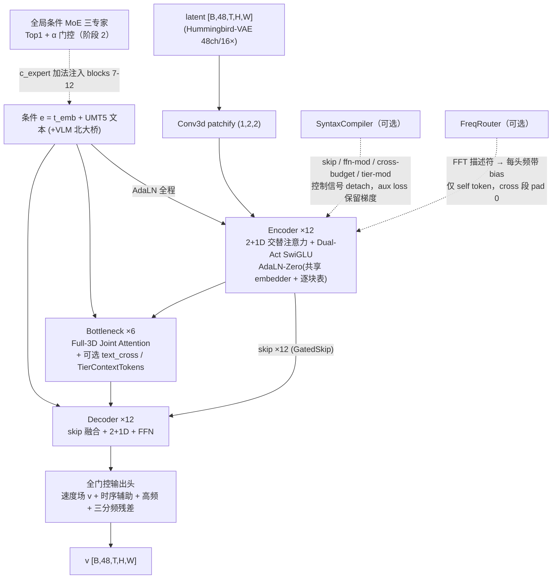

# 模型卡 · PyraGate-VLM（Project Sakiko · 4.0B 3D U-ViT 主干）

> Model card — 中文为主，关键术语附英文。版本 v3.0 · License: BSL 1.1

## 1. 模型概述

| 项 | 值 |
|---|---|
| 模型名 | PyraGate-VLM 主干（项目代号 Project Sakiko） |
| 架构 | 3D U-ViT（对称 U 型 + 长 skip）：encoder 12 / bottleneck 6 / decoder 12（全局 30 块） |
| 参数量 | **4.0B**（meta device 精确统计 3,999,944,893） |
| 隐层 | dim 3072 · 24 heads（head_dim 128）· FFN SwiGLU（mlp_ratio 8/3 参数持平） |
| 注意力 | 2+1D 时空分解（空间/时序交替）+ 瓶颈 full-3D joint；可选 GSA 门控混合；3D RoPE（t/h/w 分频，实数 fp32 表） |
| 条件注入 | 教师式 AdaLN：共享两层 embedder + 每块 (1,6,dim) 零初始化表；可选 VLM 北大桥（4096→3072）per-token CrossAttn |
| 输出头 | 全门控式头：速度场主头 + 时序辅助 + 高频细节残差（零门控起步）+ 三分频残差头 + Dual-Act 门控 + 2D RPE + 抗锯齿 + 金字塔捷径 |
| v3 可选扩展（默认关、零初始化恒等） | text_cross（低秩 UMT5 token cross-attn，σ 门控）/ AdaLNZeroText / SigmaSlidingAdapter / TierContextTokens（4 层 register token）/ SyntaxCompiler（PAU 调度，aux loss 保梯度）/ FreqRouter（FFT 描述符频带路由） |
| MoE（阶段 2） | 全局条件空间三专家（各 330M，共 0.991B），Top1 硬路由 + α 门控加法注入，α=0 严格恒等 |
| 目标范式 | 流匹配（Flow Matching）速度场预测；分阶段自监督 + 教师蒸馏（CFG-A） |
| 语言/实现 | Python / 纯 PyTorch（无 diffusers、flash-attn 硬依赖） |
| License | BSL 1.1（Change License: GPL-3.0，Change Date: 2030-01-01） |

## 2. 结构示意

## 3. 意图用途

- **用途**：视频生成研究底座——作为蒸馏学生，向教师管线对齐流匹配速度场；支持挂载风格专家、VLM 条件、语法调度与频带路由做消融。
- **适用者**：视频生成架构研究、消融实验、蒸馏训练方法验证、消费级 AMD GPU（ROCm）上的本地推理研究。
- **不适用**：面向终端用户的成品视频生成产品；对真实人物的换脸/伪造用途（见 §8）。

## 4. 训练数据

- 本地视频集合经离线 VAE 预编码为 latent；配套质量/场景/σ 分组门禁（`data_gate.py`）可按阈值筛选。
- 文本配对由 UMT5 文本嵌入管线产出；CFG-A 教师目标离线预编码为速度场 `.pt`。
- **本仓库只发布代码与脚本，不随仓库分发任何数据片段、权重或教师缓存**；运行时路径由命令行参数或环境变量给出。

## 5. 训练配置

- 教师：CFG-A 合成速度场 `v = v_uncond + 6·(v_cond − v_uncond)` → 学生推理可 CFG-free。
- 阶段：自监督流匹配 + 教师蒸馏换装；低 σ 段用精确 `noise − x0` 回填。
- 优化：主参数 Adafactor + 门控/新模块独立 AdamW（零初始化小表可训）；可选选择性 fp32 master（随机舍入写回）。
- 辅助损失：帧间 / token-boundary / 速度幅值 / 频谱 / 边界 / patch-boundary / REPA / syntax；主前向 aux 张量立即快照，避免无梯度二次前向覆盖。
- 续训守卫：形状不匹配拒绝、架构变更白名单、镜像旧 key 安全分类、优化器参数名迁移告警。
- 状态：**本仓库不含权重文件**；代码与管线已就绪。

## 6. 评测

| 层 | 内容 | 状态 |
|---|---|---|
| 结构自检 | 纯 CPU 断言（gate=0 位级恒等、RoPE 实数/复数等价、检查点前后数值一致、零门控恒等、语法零初始化恒等、detach/aux 梯度路径） | ✅ |
| 前向实测 | RX 7900 XT bf16：峰值 11.91GB @ T=16/64×64 latent，输出有限值 | ✅ |
| 生成质量 | flicker / identity / LPIPS / PSNR / SSIM 脚本就绪；教师锚点 flicker 0.0244 / 身份 0.9892 | ⏳ |

## 7. 示例

**教师参考管线输出**（蒸馏目标质量锚点；20 步 @704×480，AI 生成图像）：

| 冠军配置（混血权重 + 时序低通，flicker 0.0244） | 纯教师基线（flicker 0.0554） |
|---|---|
|  |  |

> 以上为**教师参考管线**的实拍帧，用于标注学生训练的目标质量档位；学生输出需在完成训练后另行评测。

## 8. 局限与已知边界

1. 权重未发布：仓库为"结构 + 训练管线 + 自检"；
2. GSA 为骨架实现，与 2+1D 的对照消融未跑；
3. v3 可选扩展（text_cross / syntax / freq router 等）默认关闭、零初始化恒等，启用后需配合相应 aux loss 与采样端开关；
4. bf16 训练的更新精度风险已识别（独立 AdamW 组 + 可选 fp32 master）；
5. 数据规模与课程策略对最终质量影响显著，需实测确定；
6. 本仓库不含任何本机绝对路径、私人笔记、检查点或日志。

## 9. 伦理与安全

- 生成内容可能被滥用于伪造；发布配置默认不包含任何真实人物权重/LoRA；
- 数据为公开研究用途素材，不含个人敏感采集；
- 本仓库发布代码不包含任何数据集片段或教师权重。

## 10. 引用

见 [CITATION.cff](../CITATION.cff)。技术细节见 [TECHNICAL_WHITEPAPER.md](TECHNICAL_WHITEPAPER.md)。
