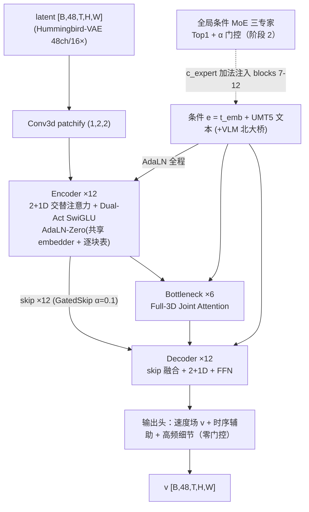

# 模型卡 · PyraGate-VLM（Udit 4.0B 3D U-ViT 主干）

> Model card — 中文为主，关键术语附英文。最后更新：2026-11-22 · 版本 v2.0 · License: BSL 1.1

## 1. 模型概述

| 项 | 值 |
|---|---|
| 模型名 | PyraGate-VLM 主干（架构代号 **Udit**） |
| 架构 | 3D U-ViT（对称 U 型 + 长 skip）：encoder 12 / bottleneck 6 / decoder 12（全局 30 块） |
| 参数量 | **4.0B**（meta device 精确统计 3,999,944,893） |
| 隐层 | dim 3072 · 24 heads（head_dim 128）· FFN SwiGLU（mlp_ratio 8/3 参数持平） |
| 注意力 | 2+1D 时空分解（空间/时序交替）+ 瓶颈 full-3D joint；可选 GSA 门控混合；3D RoPE（t/h/w 分频，实数 fp32 表） |
| 条件注入 | 教师式 AdaLN：共享两层 embedder + 每块 (1,6,dim) 零初始化表；可选 VLM 北大桥（4096→3072）per-token CrossAttn |
| MoE（阶段 2） | 全局条件空间三专家（各 330M，共 0.991B），Top1 硬路由 + α 门控加法注入，α=0 严格恒等 |
| 目标范式 | 流匹配（Flow Matching）速度场预测，20 步采样对齐教师 |
| 语言/实现 | Python / 纯 PyTorch（无 diffusers、flash-attn 硬依赖） |
| License | BSL 1.1（Change License: GPL-3.0，Change Date: 2030-01-01） |

## 2. 结构示意

## 3. 意图用途

- **用途**：本地视频生成研究底座——作为蒸馏学生，向教师管线（20 步采样）对齐流匹配速度场；支持后续挂载风格专家、VLM 条件、参考对齐编码器。
- **适用者**：视频生成架构研究、消融实验、蒸馏训练方法验证、消费级 AMD GPU（ROCm）上的本地推理研究。
- **不适用**：面向终端用户的成品视频生成产品（需完成训练与部署链）；对真实人物的换脸/伪造用途（见 §7）。

## 4. 训练数据

| 项 | 值 |
|---|---|
| 来源 | **OpenVidHD**（研究许可数据集）本地提取切段，`extracted_fast/*.mp4` → 离线 VAE latent 预编码 |
| 规模 | 1,936 条 9 帧 @704×480 latent（持续扩容中） |
| 文本配对 | OpenVidHD 官方 caption，**1,932/1,936（99.8%）配对成功**（`prompts.json`，平均 caption 538 字符）；4 条 `magictime_*` 残留待处置 |
| 配套分数 | aesthetic / motion / temporal-consistency / camera-motion 列可用于课程筛选（未启用） |
| 许可注意 | OpenVidHD 为研究许可；**本仓库只发布代码与配对脚本，不随仓库分发任何数据片段** |

## 5. 训练配置（管线已就绪）

- 教师：20 步采样管线（双轴混血权重 + 时序低通算子），CFG-A 合成速度场 `v = v_uncond + 6·(v_cond − v_uncond)` → 学生推理可 CFG-free。
- 热启动：教师 embed/head 级同构张量直拷（10 项形状校验映射）；其余新模块以教师谱 `N(0, 0.02)` 初始化。
- 优化：Adafactor + bf16 全参 + 块级梯度检查点 + 梯度累积；分批冻结计划中。
- 预算：首期 3,000 步（管线验证），RX 7900 XT 单卡约 13 小时量级；随后视指标扩展。
- 状态：**本仓库不含权重文件**——代码与管线已就绪，首次训练产出后在本节回填学生样本与指标。

## 6. 评测

| 层 | 内容 | 状态 |
|---|---|---|
| 结构自检 | 139 项纯 CPU 断言（gate=0 位级恒等、RoPE 实数/复数等价 ≤1 ULP、检查点前后数值一致、α=0 回退、4.0B 参数硬断言） | ✅ CI 全绿 |
| 前向实测 | RX 7900 XT bf16：峰值 11.91GB @ T=16/64×64 latent，输出有限值 | ✅ |
| 生成质量 | flicker / identity / LPIPS / PSNR / SSIM 全套脚本就绪；教师锚点 flicker **0.0244** / 身份 **0.9892** | ⏳ 待首训 |

## 7. 示例

**教师参考管线输出**（蒸馏目标质量锚点；20 步 @704×480，AI 生成图像）：

| 冠军配置（混血权重 + 时序低通，flicker 0.0244） | 纯教师基线（flicker 0.0554） |
|---|---|
|  |  |

> ⚠️ 以上为**教师参考管线**的实拍帧，用于标注学生训练的目标质量档位；**学生（Udit 主干）自身输出将在首训完成后回填至此**。当前请勿将上图理解为已发布模型的生成结果。

## 8. 局限与已知边界

1. 权重未发布：仓库为"结构 + 训练管线 + 自检"，主干尚未完成蒸馏训练；
2. GSA 为骨架实现，与 2+1D 的对照消融未跑；
3. 2+1D 学生与 full-3D 教师非同构——对齐依赖层特征对齐 loss（REPA 族），其效力待训练验证；
4. bf16 训练的更新精度风险已识别（分批冻结 + fp32 master 方案待启用）；
5. 数据侧：1,936 条规模偏小，课程中依赖流匹配逐步重加噪缓解过拟合，扩容继续中。

## 9. 伦理与安全

- 生成内容可能被滥用于伪造；发布配置默认不包含任何真实人物权重/LoRA，身份兜底（ReActor 对齐）属部署链且默认关闭；
- 数据为研究许可公开数据集，不含个人敏感采集；
- 本仓库发布代码不包含任何数据集片段或教师权重。

## 10. 引用

见 [CITATION.cff](../CITATION.cff)。技术细节见 [TECHNICAL_WHITEPAPER.md](TECHNICAL_WHITEPAPER.md)。
